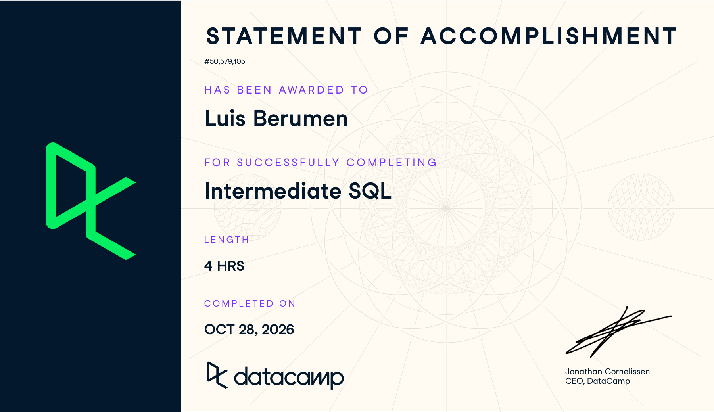
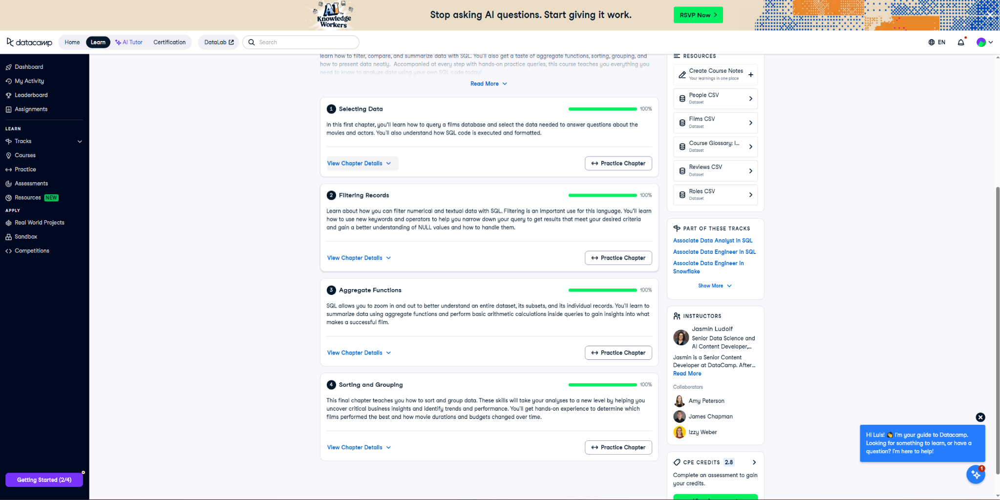

## Course-Completion Evidence

{width="100%"}

{fig-alt="All four Intermediate SQL chapters showing 100 percent completion" width="100%"}

## Selecting Data

### Main ideas

The first chapter helped me review how to select information and understand what a query is actually counting. `SELECT` chooses the columns, while `FROM` identifies the table. `COUNT(*)` counts every row, but `COUNT(column_name)` counts only rows where that column has a non-missing value. `DISTINCT` removes repeated values. This matters because the number of records is not always the number of unique films, people, or customers.

I also practiced debugging and formatting. A misspelled field name, a missing comma, or an incorrect table name can stop a query from running. Capitalizing SQL keywords, putting clauses on separate lines, and ending a statement with a semicolon make those mistakes easier to find. The written order starts with `SELECT`, but the basic logical processing order is `FROM`, then `SELECT`, then `LIMIT`.

### SQL terminology and when to use it

The main patterns are `SELECT`, `FROM`, `COUNT()`, `COUNT(DISTINCT ...)`, `AS`, and `LIMIT`. I would use a row count to check an imported dataset, a count of a field to check whether it is populated, and a distinct count to measure the number of unique categories or identifiers. An alias gives a calculated result a useful name.

### Important SQL syntax and examples

``` sql
-- Compare total records with records containing a birthdate.
SELECT COUNT(*) AS total_people,
       COUNT(birthdate) AS known_birthdates
FROM people;
```

**What the example does.** `people` is the DataCamp practice table, and `birthdate` stores a person's recorded birth date. The query returns one row with the total number of people and the number with a non-NULL birthdate. The difference between those counts tells me how many records are missing that field. It does not tell me whether the dates that are present are accurate.

``` sql
-- Count unique, known countries in the course films table.
SELECT COUNT(DISTINCT country) AS count_distinct_countries
FROM films;
```

**What the second example does.** `country` is the country field in the practice `films` table. The query counts each non-NULL country once, even when it appears on many film records. It returns a count rather than a list of the countries.

### CEP application

Our group CEP focuses on meaningful Salesforce adoption at CVRx. My part proposes a Salesforce Adoption Index using timely updates, completeness, interaction documentation, and workflow consistency. Before creating a score, I could use these counting patterns to check the size of an approved extract and whether important fields are populated. A distinct count of deidentified user IDs could help distinguish users from activity records. I would first confirm the row definition and the approved fields, since a large number of rows does not automatically mean strong adoption.

## Filtering Records

### Main ideas

This chapter showed me how to narrow the data to the records that answer a specific question. `WHERE` filters individual records before a summary is calculated. Comparison operators such as `>`, `<`, `>=`, and `=` define the boundaries. `AND` requires both conditions, while `OR` allows either condition. Parentheses are useful when combining the two because they make the intended logic clear.

`BETWEEN` includes both endpoints, and `IN` is a concise way to test several allowed values. `LIKE` matches a text pattern: `%` means any number of characters and `_` means exactly one character. `NOT LIKE` excludes a pattern. I also learned that `NULL` represents missing or unknown information. It is different from a zero or an empty string, and I test for it with `IS NULL` or `IS NOT NULL`.

### SQL terminology and when to use it

I would use `WHERE` to define the period, population, or categories included in an analysis. `IN` works well for a list of categories, while `BETWEEN` works for an inclusive range. A pattern search can help inspect names or text labels, and missing-value checks can identify fields that need review.

### Important SQL syntax and examples

``` sql
-- Count unique English-language titles from the 1990s with selected ratings.
SELECT COUNT(DISTINCT title) AS nineties_english_films_for_teens
FROM films
WHERE release_year BETWEEN 1990 AND 1999
  AND language = 'English'
  AND certification IN ('G', 'PG', 'PG-13');
```

**What the example does.** This filters the course data to films from 1990 through 1999, in English, with one of the three listed certifications. It then counts distinct titles. `title`, `release_year`, `language`, and `certification` are the corresponding fields in the practice `films` table. Counting distinct titles avoids repeated title values in this exercise, but a real film analysis should use a reliable film identifier because different films can share a title.

``` sql
-- Require the same year and budget criteria for both languages.
SELECT title, release_year
FROM films
WHERE release_year BETWEEN 1990 AND 2000
  AND budget > 100000000
  AND (language = 'Spanish' OR language = 'French');
```

**What the second example does.** This returns titles and years for Spanish- or French-language films with budgets above 100 million, released from 1990 through 2000. The parentheses ensure the date and budget restrictions apply to both languages. The numeric threshold is written without commas or a currency symbol.

``` sql
-- Inspect films whose budget information is missing.
SELECT title AS no_budget_info
FROM films
WHERE budget IS NULL;
```

**What the third example does.** This lists titles with missing budgets. It does not find zero-budget films. That distinction matters because missing information cannot be treated as a measured zero without a reason.

### CEP application

For CVRx, filters could define a consistent observation period or compare approved roles and territories. Missing-value checks could support a completeness measure, but only for fields that should be completed for that workflow. A blank optional field should not automatically reduce a user's adoption score. Pattern searches could help identify inconsistent labels before grouping records. I would keep the same filters across comparisons so differences are not caused by changing the included population.

## Aggregate Functions

### Main ideas

This chapter moved from viewing records to calculating summaries. `SUM()` adds values, `AVG()` calculates the mean, `MIN()` returns the lowest value, and `MAX()` returns the highest. `COUNT()` measures the number of rows or non-missing field values, depending on its argument. The aggregate functions used in these exercises ignore NULL input values, while `COUNT(*)` counts rows. Averages therefore need context about missing data and the denominator.

I also practiced arithmetic, aliases, and rounding. The course's SQL environment uses integer division when both operands are integers, so `2 / 10` produces `0`. Using a decimal such as `10.0` preserves a fractional result. `ROUND(value, 2)` rounds to two decimal places, while a negative precision such as `-3` rounds to thousands.

### SQL terminology and when to use it

I would use aggregates for total activity, average values, ranges, and completeness percentages. `WHERE` lets me summarize a selected subset. Aliases explain the meaning of the result, and `ROUND()` makes a displayed number easier to read. I would keep enough precision during the calculation and round the final result so it is easier to read.

### Important SQL syntax and examples

``` sql
-- Calculate average gross for films whose titles begin with A.
SELECT AVG(gross) AS avg_gross_A
FROM films
WHERE title LIKE 'A%';
```

**What the example does.** The query filters titles beginning with uppercase A, then averages their non-NULL `gross` values in the course table. Films with missing gross do not contribute a zero; they are excluded from the average. This result summarizes the matching records rather than returning each film.

``` sql
-- Convert minutes to hours and round the display.
SELECT title,
       ROUND(duration / 60.0, 2) AS duration_hours
FROM films;
```

**What the second example does.** `duration` is measured in minutes in the practice data. Dividing by `60.0` converts each value to hours without integer truncation. The query returns one result per film, with the calculated hours rounded to two decimal places. This is a row-level calculation rather than an aggregate.

``` sql
-- Calculate the percentage of records with a recorded deathdate.
SELECT ROUND(COUNT(deathdate) * 100.0 / COUNT(*), 2) AS percentage_dead
FROM people;
```

**What the third example does.** This counts non-missing `deathdate` values and divides by the total people records, then multiplies by 100 and rounds. In the exercise, that is used as the percentage deceased. In real data, a missing death date alone is not proof that someone is alive. The query assumes a nonempty table; a production version could protect an empty denominator with `NULLIF(COUNT(*), 0)`.

### CEP application

These patterns could help calculate the percentage of eligible opportunity records containing a required field or summarize documented interactions. For example, dividing the count of populated required values by the count of eligible records could produce a completeness percentage. The table's row definition and field rules would need to be approved first. I would avoid adding measures with different scales directly together: percentages, counts, and elapsed times would need suitable normalization and agreed weights before becoming an Adoption Index.

## Sorting and Grouping

### Main ideas

The final chapter helped me turn individual records into comparisons between groups. `ORDER BY` sorts results in ascending order by default, while `DESC` reverses the direction. Multiple sorting fields are applied in the listed order. `GROUP BY` creates groups for aggregate calculations. If I select a nonaggregated field along with an aggregate, that field generally needs to be included in the grouping.

The most useful distinction was between `WHERE` and `HAVING`. `WHERE` filters the input records before grouping, while `HAVING` filters the groups after aggregation. A useful logical sequence for these exercises is `FROM`, `WHERE`, `GROUP BY`, `HAVING`, `SELECT`, `ORDER BY`, and `LIMIT`. This explains why an alias defined in `SELECT` can be used for sorting but generally is not available in `WHERE`.

### SQL terminology and when to use it

I would use grouping to compare categories or periods, sorting to make the comparison readable, and `HAVING` to keep groups meeting a summary threshold. `LIMIT` can produce a short ranked result, but a meaningful top result also needs an appropriate `ORDER BY`.

### Important SQL syntax and examples

``` sql
-- Find the maximum budget within each year and country.
SELECT release_year, country, MAX(budget) AS max_budget
FROM films
GROUP BY release_year, country
ORDER BY release_year, country;
```

**What the example does.** This creates one group for each combination of release year and country. It returns the highest non-NULL budget in each group, sorted first by year and then alphabetically by country. Grouping by two fields creates more specific summaries than grouping by country alone.

``` sql
-- Find the qualifying year with the highest average gross.
SELECT release_year,
       AVG(budget) AS avg_budget,
       AVG(gross) AS avg_gross
FROM films
WHERE release_year > 1990
GROUP BY release_year
HAVING AVG(budget) > 60000000
ORDER BY avg_gross DESC
LIMIT 1;
```

**What the second example does.** This first restricts the records to releases after 1990. It calculates average budget and gross for each year, keeps years whose average budget exceeds 60 million, and returns the remaining year with the highest average gross. It does not identify the single highest-grossing film. Missing budgets and gross values are omitted from their respective averages, so the two averages may use different numbers of records. If years tie, the query does not specify a tie-breaker.

### CEP application

Grouping could help our CVRx team compare approved adoption measures by role, territory, or reporting month. `HAVING` could restrict a summary to groups with a sufficient number of eligible records, reducing the chance that a tiny group drives an interpretation. Sorting would help show which groups need follow-up, but a high count alone would not prove better adoption. Workload and responsibilities need to be considered, and small groups should not expose individual users. These summaries could help our group plan targeted engagement and later compare results using consistent definitions.

## Overall Reflection and Series Synthesis

The most useful patterns for me were combining filters with aggregate functions and separating `WHERE` from `HAVING`. Introduction to SQL gave me the foundation for choosing fields and understanding tables. Intermediate SQL extended that foundation by showing me how to define a subset, calculate a summary, group the results, and sort them around a specific question. The final exercise brought those steps together in one query.

The areas I needed to check most carefully were parentheses with `AND` and `OR`, missing values, and the difference between a row-level calculation and an aggregate. Breaking a larger query into steps helped me follow the logic: choose the fields, apply row filters, add grouping and averages, apply the group filter, and finally sort. I would use that same approach when adapting the examples later. I also learned to check the existing exercise query before changing it, because a correct calculation for a different question still does not answer the intended question.

The BigQuery course added the cloud environment around SQL: projects, datasets, table schemas, nested records, and the work involved in processing a query. Many of these Intermediate SQL patterns can be used in BigQuery after adjusting table names and checking syntax and data types. For example, I would qualify an approved table as `project.dataset.table` and confirm the field types before using arithmetic or rounding. The integer-division behavior shown in this course should not be assumed to behave identically across SQL systems.

For digital marketing, these skills could summarize campaign transactions, compare customer segments, or review missing survey responses. A survey average should use the intended respondent population and account for unanswered items. For our CVRx CEP, I could use the same logic to prepare approved Salesforce data for the proposed Adoption Index, compare relevant groups, and support evaluation of a targeted engagement effort. All CEP applications here are proposed uses; the course film queries do not analyze actual CVRx records.

I expect to revisit the filtering chapter for observation windows and missing values, the aggregate chapter for percentages and denominators, and the grouping chapter for comparisons over time. Together, the three reports give me a reference for moving from raw records to an organized summary that I can explain. I would return to these examples when I need to reconstruct a query or explain how a result was calculated.

## Appendix: Publication Links

- [GitHub Repository](https://github.com/Brahhmen55/ibm-6500-sql-learning-portfolio)
- [Published Intermediate Sql Report](https://brahhmen55.github.io/ibm-6500-sql-learning-portfolio/intermediate-sql/)
